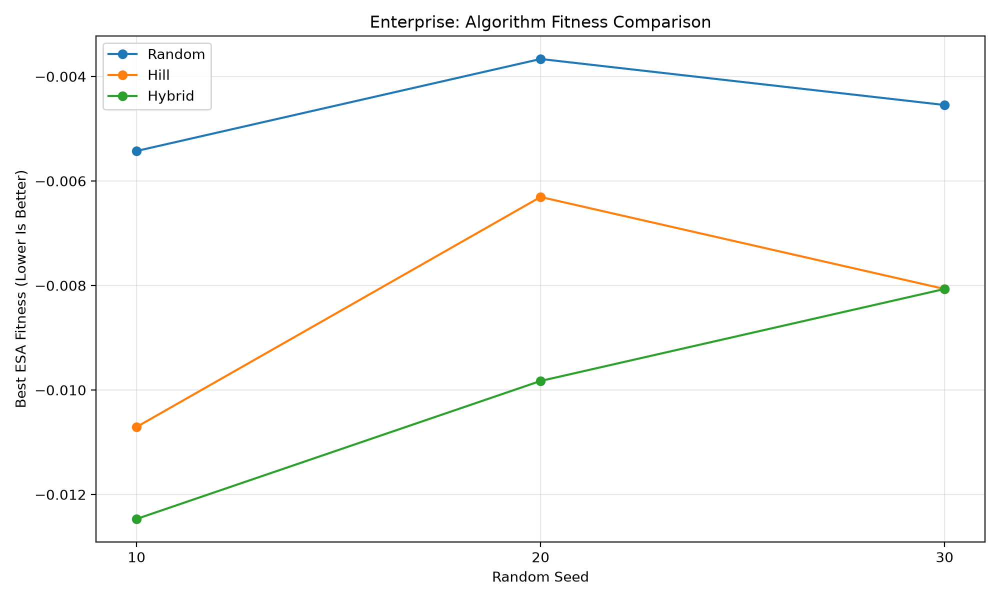
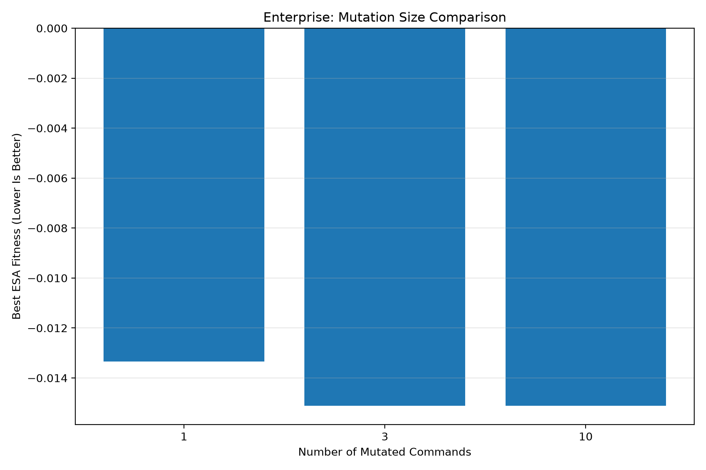
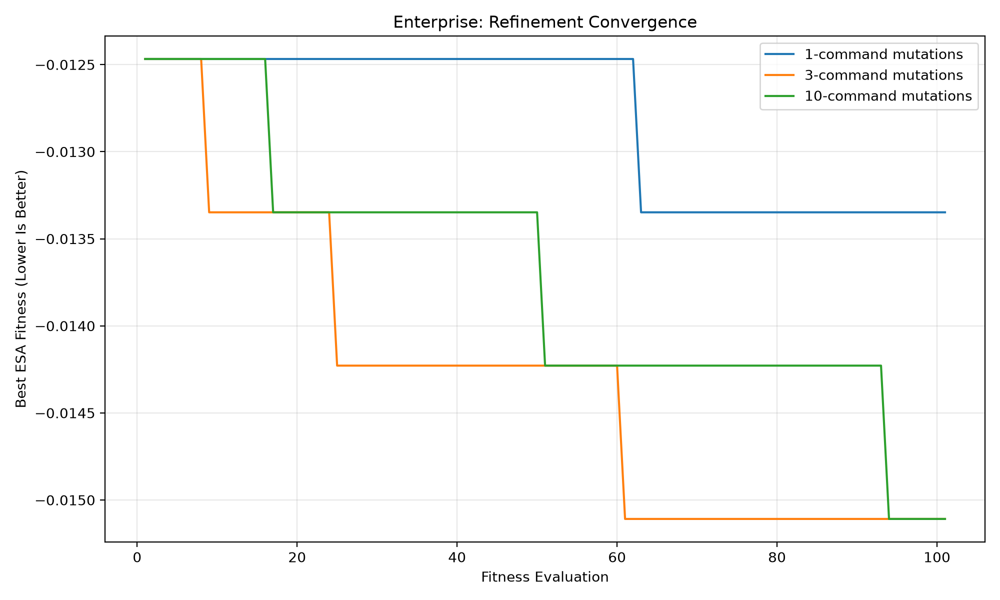

# Enterprise — Experiment Results

## 1. Problem Description

The Enterprise scenario is part of ESA's SpOC-3
Programmable Cubes challenge.

The objective is to optimize sequences of movement commands
using the official ESA simulation and fitness evaluator.

### Enterprise Configuration

- Number of cubes: 1,472
- Number of cube types: 10
- Maximum permitted commands: 100,000
- Commands used in reported experiments: 100

Each chromosome represents a sequence of cube movement commands.

The official ESA fitness evaluator was used to assess
candidate solutions. Lower fitness values indicate better
results.

## 2. Implemented Algorithms

### Random Search

Random Search generates candidate chromosomes and evaluates
them independently.

The algorithm preserves the best solution encountered.

### Hill Climbing

Hill Climbing begins with an initial candidate chromosome
and modifies selected commands.

A mutated candidate is retained when its fitness improves
upon the current best solution.

### Hybrid Search

Hybrid Search combines legal-movement initialization
with iterative mutation-based optimization.

The initial chromosome is constructed using accepted
movements before additional optimization.

### Refinement Search

Refinement Search starts with the best Hybrid Search
chromosome and applies mutations of different sizes.

Three mutation sizes were evaluated:
1, 3, and 10 commands.

## 3. Experimental Environment

- Programming language: Python
- Execution platform: Kaggle CPU
- Development environment: Visual Studio Code
- Fitness evaluation: Official ESA simulator
- Recorded results: JSON files and NumPy chromosomes
- Visualization: Matplotlib

Source code was developed in VS Code and executed on Kaggle
for computationally intensive experiments.

## 4. Initial Experiment — Enterprise V1

Settings:

- Seeds: 10, 20, 30
- Commands: 100
- Evaluations per algorithm per seed: 20
- Total requested evaluations: 180

| Algorithm     | Mean Fitness | Best Fitness |
| ------------- | -----------: | -----------: |
| Random Search | -0.004251956 | -0.005425665 |
| Hill Climbing | -0.002491393 | -0.003665102 |
| Hybrid Search | -0.005132238 | -0.005425665 |

Hybrid Search achieved the best mean fitness in the initial
experiment.

Random Search and Hybrid Search tied for the best
individual result.

## 5. Extended Experiment — Enterprise V2

Settings:

- Seeds: 10, 20, 30
- Commands: 100
- Evaluations per algorithm per seed: 100
- Total requested evaluations: 900

| Algorithm     |      Seed 10 |      Seed 20 |      Seed 30 |
| ------------- | -----------: | -----------: | -----------: |
| Random Search | -0.005425665 | -0.003665102 | -0.004545383 |
| Hill Climbing | -0.010707355 | -0.006305947 | -0.008066510 |
| Hybrid Search | -0.012467919 | -0.009827074 | -0.008066510 |

The best fitness from the extended experiment was:

**-0.012467918622848122**

This result was produced by Hybrid Search with Seed 10.

Hybrid Search achieved the best fitness for Seeds 10 and 20
and tied with Hill Climbing for Seed 30.

## 6. Refinement Experiments

The best Hybrid Search chromosome was selected as the
baseline for further optimization.

Baseline fitness:

**-0.012467918622848122**

Each mutation size was tested using 100 evaluations.

| Mutation Size | Best Fitness | Improvements |    Time |
| ------------- | -----------: | -----------: | ------: |
| 1 command     | -0.013348200 |            1 | 11.63 s |
| 3 commands    | -0.015108764 |            3 | 11.86 s |
| 10 commands   | -0.015108764 |            3 | 11.92 s |

Both 3-command and 10-command mutation strategies reached
the same best fitness value.

Mutation size 3 was selected as the representative best
solution. Both best chromosomes were preserved.

## 7. Final Result

The best verified fitness achieved was:

**-0.015108763693270667**

The final chromosome contains 100 movement commands.

The result was verified using the official ESA fitness
function.

This represents the best solution found during the reported
experiments, not a claim that every cube reached its target.

## 8. Visualizations

The following figures were generated from saved experiment
results:

### Algorithm Comparison

### Mutation Size Comparison

### Refinement Convergence

## 9. Limitations

- Experiments used 100 commands, below the maximum allowed.
- Three random seeds were used for algorithm comparisons.
- Additional experiments could provide stronger statistical
  evidence.
- Hybrid Search performs extra legal-movement generation
  work that is not captured by fitness evaluation counts.
- The experiments do not demonstrate complete assembly of
  the Enterprise target configuration.

## 10. Conclusion

The experiments demonstrated the implementation and
evaluation of Random Search, Hill Climbing, Hybrid Search,
and mutation-based refinement on the Enterprise scenario.

Hybrid Search produced the strongest results during the
extended comparison, while refinement further improved
the best chromosome.

The final verified fitness was -0.015108763693270667.

All reported optimization results were generated using
ESA's official simulator on Kaggle, with chromosomes,
statistics, and checkpoints retained for reproducibility.
